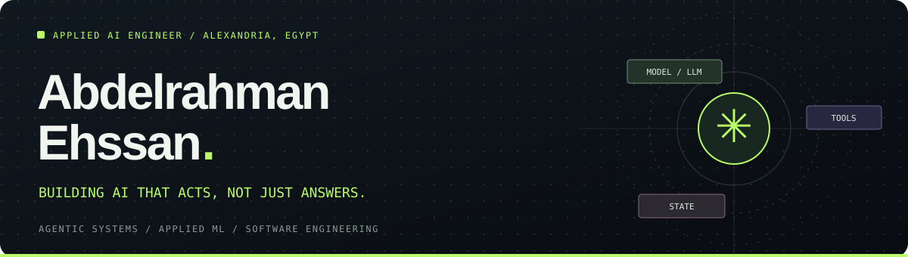

 

**Applied AI Engineering Intern @ Cycls** · **AI Student @ Alexandria University**

*I build AI that acts, not just answers — connecting models to tools, APIs, and real software workflows.*

 

<!-- After you deploy your website, add a Portfolio button here with its actual URL. -->

### What I work on

- **Agentic AI systems:** LLM tool use, multi-step workflows, execution boundaries, state, and reliability.
- **Backend & platform integrations:** Python, FastAPI, REST APIs, authorization flows, and robust error handling.
- **Applied machine learning:** scikit-learn pipelines, data processing, model inference, and interactive applications.

Currently contributing to AI-enabled product engineering at **[Cycls](https://github.com/Cycls)**. My industry work is described at a high level; private company source code remains private.

### Featured: Lear_nova — adaptive AI learning

**Graduation project · AI / ML & backend contributor · Team project**

Lear_nova is an AI-powered adaptive learning platform. My contributions focus on the **Python AI/backend service layer**, including retrieval-assisted learning, diagnostic assessment and scoring, tutor integrations, personalization, and analytics workflows. The wider project also includes a Flutter app and Supabase-backed data services.

**Ownership note:** This was collaborative work. The public service repository is **my fork of a friend's repository**, containing the work I contributed; it is not presented as a solo-built version of the entire platform.

[Explore my Lear_nova scoring service →](https://github.com/AbdelrahmanEhssan/learnova_scoring_service)

### Selected projects

| Project | What it demonstrates | Code / Demo |
| :-- | :-- | :-- |
| **Lear_nova — Adaptive Learning Platform** | Team EdTech graduation project; RAG-assisted learning, FastAPI scoring, AI tutor integrations and personalization (my AI/backend contributions in a fork) | [My scoring service](https://github.com/AbdelrahmanEhssan/learnova_scoring_service) |
| **FindIt — Lost & Found Platform** | Full-stack FastAPI app, authenticated flows, PostgreSQL, Docker, cloud deployment structure | [Repository](https://github.com/AbdelrahmanEhssan/findit-lost-found-platform) |
| **Student GPA Predictor** | ML workflow, scikit-learn regression with simulated data, Streamlit inference UI | [Repository](https://github.com/AbdelrahmanEhssan/gpa-predictor-streamlit) · [Live app](https://gpa-predictor-app.streamlit.app/) |
| **Stock Market Dashboard** | Financial data ingestion, pandas transformations, stock comparisons and moving averages | [Repository](https://github.com/AbdelrahmanEhssan/stock-dashboard-streamlit) |
| **Titanic Survivor Predictor** | Classification, decision-tree model and probability estimates in Streamlit | [Repository](https://github.com/AbdelrahmanEhssan/titanic-survivor-streamlit) |

### Toolbox

**AI / ML** &nbsp; `RAG` · `Embeddings` · `LLMs` · `AI agents` · `scikit-learn` · `pandas` · `NumPy` · `Streamlit`

**Engineering** &nbsp; `Supabase` · `PostgreSQL` · `Python` · `FastAPI` · `REST APIs` · `pytest` · `Docker` · `Git`

**Systems** &nbsp; `Tool calling` · `Structured outputs` · `Provider integrations` · `Stateful workflows`

### How I approach engineering

> **Useful → Reliable → Understandable.** The model is just one part of the system; the interfaces, validation, failure modes, and user experience matter just as much.

### Let's connect

📍 Alexandria, Egypt · 🌐 [LinkedIn](https://www.linkedin.com/in/abdelrahman-ehssan/) · 💻 [My repositories](https://github.com/AbdelrahmanEhssan?tab=repositories)

<!-- Optional, once verified: a link to your portfolio, a CV PDF, or a public email address. -->
